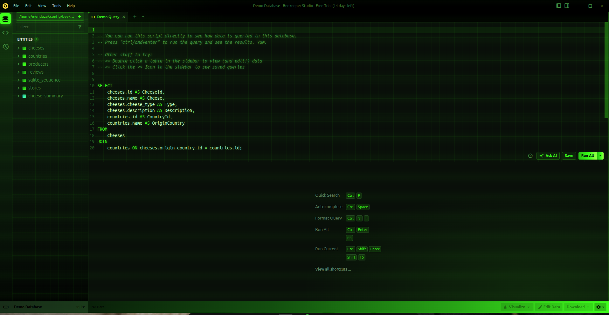
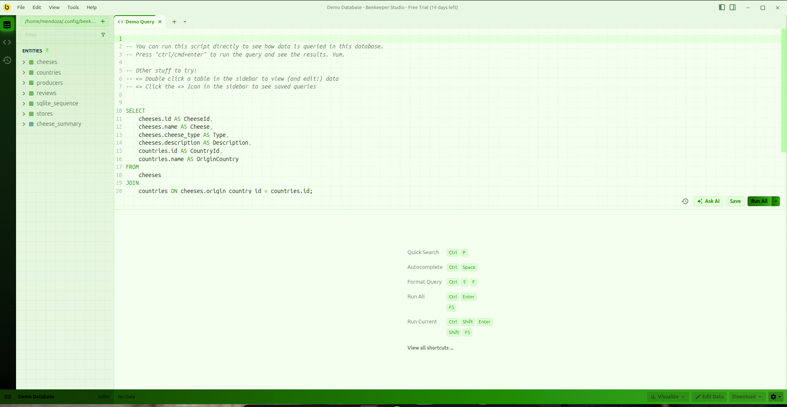

# Matrix for Beekeeper Studio

Pure black and phosphor lime green, with a terminal grid and CRT glow. Wake up, Neo.

A free community theme for [Beekeeper Studio](https://www.beekeeperstudio.io/).





## Features

- **Dark mode** (the main one): pure `#000000` background, lime `#39ff14` accents, green-only syntax highlighting with subtle hue shifts so keywords, strings, functions and comments stay distinguishable.
- **Light mode** ("terminal paper"): dark green on a pale green-cream background.
- Terminal grid behind the sidebar and query editor.
- Phosphor glow on editor text, glowing primary button, active cell and sidebar icon.
- Gradient column headers in the results table.
- CRT scanline overlay (dark mode only).

Tested with Beekeeper Studio 6.3.x.

## Installation

### From Beekeeper Studio (recommended)

Once the theme is listed in the community registry, open **Appearance** settings in Beekeeper Studio, find **Matrix** among the community themes and install it.

### Manual

1. Download `matrix-<version>.zip` from the [latest release](https://github.com/pintamonas4575/beekeeper-studio-matrix-theme/releases/latest).
2. Extract it into a folder named `matrix` inside your Beekeeper Studio themes directory, so you end up with `themes/matrix/manifest.json` and `themes/matrix/style.css`. On Linux that is `~/.config/beekeeper-studio/themes/matrix/`.
3. Restart Beekeeper Studio and pick **Matrix** in **Appearance**.

## Customization

- **Performance:** the CRT scanline overlay is a full-window decorative layer. If you notice any slowdown, delete the `body.dark-theme::after` block at the end of `style.css`.
- **Colors:** all theme colors are CSS variables prefixed with `--mx-` at the top of `style.css` (`.dark-theme` and `.light-theme`).

## Releasing (maintainers)

1. Bump `version` in `manifest.json` (semver).
2. Commit, then tag and push with a matching tag:
   ```sh
   git tag v1.0.0
   git push origin main --tags
   ```
3. The GitHub Action builds `matrix-<version>.zip` and publishes a release with that zip and `manifest.json` attached.

## License

[MIT](LICENSE) — free to use, modify and share.
